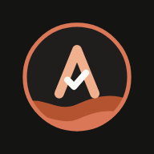
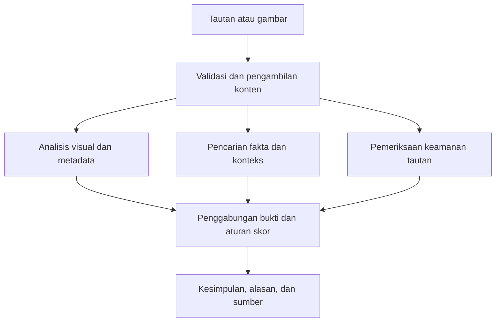
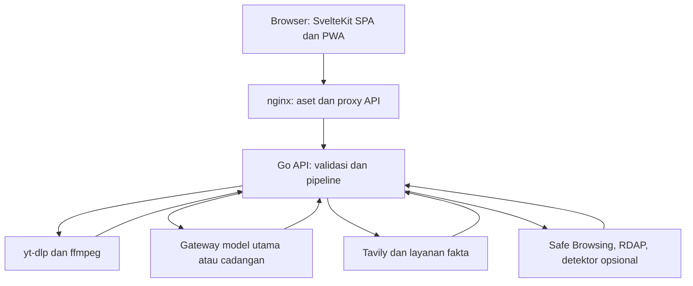

<div align="center">



# AMBA
### Aplikasi Mengenali & Bertindak Aman

**Periksa sebelum percaya. Pahami sebelum membagikan.**

Pendamping literasi digital untuk memeriksa indikasi konten AI, manipulasi gambar, klaim menyesatkan, dan tautan berisiko—dengan alasan yang dapat dipahami dan sumber yang dapat ditelusuri.

[](https://amba.madewadigital.com/)
[](https://amba.madewadigital.com/deteksi)
[](https://amba.madewadigital.com/edukasi)

**MIT-Week Web Development 2026 · Tim Pecut Claude · Bahasa Indonesia**

</div>

> Sebuah video terlihat meyakinkan. Sebuah tangkapan layar memakai nama media terkenal. Sebuah tautan mengaku berasal dari layanan resmi. **Bagaimana kita memutuskan apa yang layak dipercaya?** AMBA membantu memeriksa tanda-tandanya sebelum kita mengambil tindakan.

## 🧭 Jelajahi AMBA

[Kenapa AMBA?](#kenapa-amba) · [Tur untuk juri](#tur-juri) · [Semua fitur](#fitur) · [Cara kerja AI](#cara-kerja) · [Membaca hasil](#hasil) · [Privasi](#privasi) · [Dokumentasi teknis](#teknis) · [Tim](#tim)

<a id="kenapa-amba"></a>
## 💡 Dari rasa ragu menjadi keputusan yang lebih sadar

Konten menyesatkan tidak selalu berupa gambar palsu. Rekaman asli dapat diberi keterangan yang keliru, judul berita dapat ditimpa, dan tautan dapat menyerupai situs resmi. Karena itu, AMBA menggabungkan pemeriksaan visual, asal-usul konten, konteks informasi, dan keamanan tautan dalam satu alur.

AMBA dirancang untuk masyarakat umum dan keluarga, termasuk pengguna yang belum terbiasa dengan istilah teknis. Pengguna cukup menempelkan tautan atau mengunggah gambar. Kesimpulan ditampilkan lebih dahulu; bukti dan penjelasan tersedia ketika ingin ditelusuri lebih jauh.

| Kebutuhan pengguna | Jawaban AMBA |
|---|---|
| “Ini gambar atau video buatan AI?” | Memeriksa petunjuk visual, metadata, label AI, dan pengakuan pembuat yang tersedia. |
| “Videonya nyata, tetapi keterangannya benar?” | Memeriksa kecocokan konteks, merangkum isi video, dan menelusuri berita atau pemeriksaan fakta terkait. |
| “Judul dalam screenshot ini sudah diedit?” | Menggabungkan analisis perbedaan kompresi gambar dengan temuan visual pada area teks. |
| “Tautan ini mengarah ke tempat yang aman?” | Memeriksa struktur URL, pengalihan, domain tiruan, serta reputasi dan umur domain jika layanan terkait aktif. |
| “Mengapa hasilnya seperti itu?” | Menampilkan alasan utama, peta risiko, rincian pemeriksaan, dan tautan sumber. |
| “Bagaimana agar saya bisa memeriksa sendiri?” | Menyediakan materi singkat, latihan visual, kuis, dan rujukan pemeriksaan mandiri. |

**Nilai yang ingin dibawa:** memperpendek langkah awal verifikasi dan membantu pengguna membangun kebiasaan memeriksa informasi. Manfaat tersebut merupakan tujuan desain; proyek ini tidak mengklaim jumlah pengguna, penurunan penyebaran hoaks, atau akurasi populasi yang belum diukur.

<a id="tur-juri"></a>
## 🎬 Tur singkat untuk juri

1. **Buka [Beranda AMBA](https://amba.madewadigital.com/).** Kenali alur input, pemeriksaan, dan hasil tanpa membuat akun.
2. **Masuk ke [Deteksi](https://amba.madewadigital.com/deteksi).** Pilih salah satu contoh bawaan: video TikTok, gambar AI, atau tangkapan layar berita yang diedit. Contoh diberi label simulasi dan tidak menjalankan analisis AI baru.
3. **Telusuri hasil.** Baca kesimpulan, skor risiko, alasan utama, peta risiko, dan rincian bukti yang tersedia. Pada contoh gambar, jelajahi perbandingan gambar dengan visualisasi ELA.
4. **Coba konten sendiri.** Tempel tautan publik atau unggah gambar JPEG, PNG, atau WebP maksimal 10 MB. Perhatikan progres pemeriksaan dan perbedaan hasil sesuai jenis masukan.
5. **Buka [Belajar](https://amba.madewadigital.com/edukasi).** Coba latihan gambar dan kuis untuk melihat bagaimana AMBA menghubungkan pemeriksaan dengan pendidikan pengguna.

> **Pegangan saat menilai:** contoh simulasi menunjukkan pengalaman penggunaan. Pemeriksaan konten sendiri membutuhkan backend dan layanan yang aktif. Hasil AMBA bersifat indikatif, bukan kepastian keaslian atau alat bukti hukum.

<a id="fitur"></a>
## ✨ Fitur yang dapat dijelajahi

### 1. Satu pintu untuk tautan dan gambar

| Fitur | Yang dilakukan |
|---|---|
| Tautan web dan berita | Mengambil metadata atau isi yang dapat diakses, mengekstrak klaim, dan memeriksa tautannya. |
| Tautan media sosial | Jalur analisis video untuk TikTok, YouTube termasuk Shorts, Instagram, Facebook, dan X; keberhasilan bergantung pada akses publik dan pembatasan platform. |
| Unggah gambar | Mendukung JPEG, PNG, dan WebP statis; pemilihan berkas, pratinjau, dan seret-lepas di halaman Deteksi. Batas antarmuka 10 MB. |
| Teks bagikan | Mengambil URL dari teks seperti “Lihat ini https://…”, sehingga pengguna tidak perlu membersihkan pesan secara manual. Ini bukan pemeriksaan teks bebas tanpa tautan. |
| Validasi sebelum dikirim | Memberi pesan untuk tautan tidak valid, format gambar tidak didukung, dan berkas terlalu besar. |
| Progres pemeriksaan | Menampilkan tahapan dan temuan sementara melalui Server-Sent Events, disertai opsi membatalkan dan mencoba lagi. |
| Contoh siap jelajah | Tiga hasil simulasi bawaan untuk memahami pengalaman AMBA tanpa panggilan model baru. |
| Riwayat sesi | Menampilkan hingga 20 pemeriksaan dalam memori sesi: nama konten, status, skor, penanda demo, tombol hapus riwayat, dan pemeriksaan ulang untuk tautan yang didukung. Hilang saat halaman dimuat ulang. |

### 2. Empat lapisan pemeriksaan

| Lapisan | Bukti yang diperiksa | Manfaat bagi pengguna |
|---|---|---|
| **Jejak AI** | Analisis visual model, metadata asal-usul, label AI, dan pengakuan pembuat; detektor gambar khusus tersedia secara opsional. | Mengetahui indikasi konten dibuat atau diubah dengan AI beserta alasannya. |
| **Manipulasi gambar / ELA** | Perbedaan kompresi dan area mencurigakan, khususnya indikasi teks yang ditimpa. | Melihat bagian gambar yang layak diperiksa lebih lanjut. |
| **Cek fakta** | Klaim dibandingkan dengan hasil pencarian dari sumber yang diizinkan dan membahas topik terkait. | Menelusuri apakah klaim didukung, dibantah, atau belum terverifikasi. |
| **Keamanan tautan** | Struktur URL, redirect, domain menyerupai merek, reputasi berbahaya dan umur domain ketika tersedia. | Mengenali kemungkinan jebakan sebelum mengikuti tautan. |

Lapisan yang tidak relevan atau tidak tersedia tidak diperlakukan sebagai bukti bahwa konten asli. Tampilan menyesuaikan jenis input; misalnya pemeriksaan ELA gambar tidak ditampilkan sebagai pemeriksaan video.

<details>
<summary><strong>🔎 Buka rincian analisis gambar</strong></summary>

- **Jejak asal-usul:** membaca penanda pada C2PA/Content Credentials, XMP, EXIF, dan blok teks PNG, termasuk nama perangkat atau perangkat lunak pembuat jika ada. Pembacaan penanda metadata bukan verifikasi kriptografis lengkap atas keaslian C2PA.
- **Petunjuk visual AI:** model menilai tanda yang terlihat dan memberikan indikator terstruktur. Bila diaktifkan, Sightengine menambahkan sinyal deteksi gambar AI.
- **Pembacaan teks:** teks hasil pembacaan model dapat dipakai untuk pemeriksaan klaim, tautan, dan taktik manipulasi.
- **ELA di server:** menghitung sinyal perbedaan kompresi untuk membantu menemukan penyuntingan. Temuan dapat diperkuat oleh kesesuaian lokasi dengan anomali teks dari analisis model.
- **ELA di browser:** Web Worker menyiapkan visualisasi perbandingan tanpa mengambil alih perhitungan skor akhir server. Pengguna dapat menggeser pembanding gambar dan melihat area anomali yang tersedia.
- **Keterbatasan:** metadata dapat hilang atau dipalsukan; hasil kompresi dipengaruhi penyimpanan ulang. Area terang pada ELA bukan bukti tunggal pemalsuan.

</details>

<details>
<summary><strong>🎞️ Buka rincian analisis video dan konteks</strong></summary>

- `yt-dlp` mengambil materi yang dapat diakses; `ffmpeg` mengekstrak bingkai dan audio. Jalur bawaan menyiapkan 6 bingkai; ekstraksi audio dibatasi hingga 90 detik. Ini analisis sampel, bukan inspeksi setiap bingkai seluruh video.
- Sistem memiliki pembatas sumber daya, termasuk batas durasi video 30 menit dan ukuran unduhan 60 MB pada konfigurasi fetcher bawaan; batas waktu dapat membuat pengambilan selesai lebih awal atau gagal.
- Model memeriksa **indikasi AI**, **penyuntingan menyesatkan**, dan **ketidakcocokan keterangan dengan rekaman** sebagai sinyal terpisah.
- Hasil dapat memuat bingkai beserta waktunya, platform, durasi, tanggal unggahan, ringkasan, transkrip/subtitel yang tersedia, serta penjelasan apakah audio benar-benar dianalisis.
- Ringkasan **5W1H** membantu membaca siapa, apa, kapan, di mana, mengapa, dan bagaimana. Informasi yang tidak tersedia tidak harus terisi.
- Judul, deskripsi, tag, dan identitas akun diperiksa untuk pengakuan pembuatan AI. Penanda kuat seperti nama generator diperlakukan berbeda dari penyebutan umum `#ai`; penyebutan AI dalam konteks pemberitaan disaring.
- Tavily dapat mencari jejak video di sumber berita dan cek fakta. Temuan disaring berdasarkan kesamaan topik, lalu diklasifikasikan sebagai terkait AI, hoaks, asli, atau tidak relevan. Maksimal 5 bukti ditampilkan.
- **Jejak penelusuran** menggabungkan sumber terkait yang sudah ditemukan. Bila sumber masih sedikit, pencarian tambahan dapat memakai kata kunci isi video atau 5W1H. Daftar bacaan terkait tidak otomatis berarti semua sumber membuktikan kesimpulan yang sama.
- Bila video tidak dapat diunduh, sistem dapat menggunakan metadata atau gambar pratinjau yang tersedia; basis pratinjau dibedakan dari analisis rekaman.
- Analisis audio hanya aktif jika `LLM_AUDIO_INPUT` atau konfigurasi audio gateway cadangan diaktifkan dan model mendukungnya.

</details>

<details>
<summary><strong>🌐 Buka rincian sumber fakta dan keamanan tautan</strong></summary>

**Pencarian yang dapat ditelusuri.** Integrasi cek fakta mendukung Google Fact Check Tools, Tavily, serta pencarian berita cadangan sesuai konfigurasi. Sumber harus berasal dari hasil penelusuran sistem dan lolos daftar domain yang diizinkan; model tidak boleh menjadikan URL karangannya sebagai bukti.

Daftar cek fakta utama mencakup TurnBackHoax, CekFakta, Komdigi/Kominfo, ANTARA, Kompas, Detik, Tempo, CNN Indonesia, Liputan6, dan Tirto. Jalur penelusuran video memakai daftar berita/cek fakta tersendiri yang lebih luas. Pencocokan topik mendukung normalisasi istilah Indonesia, seperti “wapres” dan “wakil presiden”. Daftar utama ada di [`configs/trusted_sources.yaml`](configs/trusted_sources.yaml); implementasi filter ada di [`grounding`](backend/internal/grounding/).

**Keamanan tautan.** Pemeriksaan mencakup pola URL mencurigakan, pengalihan, nama merek pada domain lain, salah eja menyerupai merek, dan karakter yang secara visual menyerupai huruf Latin. Google Safe Browsing menambah pemeriksaan reputasi ketika kunci tersedia; RDAP menambah informasi umur domain ketika aktif. Domain baru atau struktur mencurigakan merupakan indikator, bukan pembuktian tunggal penipuan.

**Taktik manipulasi.** AMBA dapat menyorot frasa yang cocok dengan delapan kategori: mendesak, iming-iming hadiah, mengaku otoritas, menakut-nakuti, meminta dirahasiakan, memancing emosi, menyamar, dan klaim banyak orang sudah percaya. Sorotan dikaitkan dengan teks yang benar-benar tersedia pada input.

</details>

### 3. Hasil yang bisa dipahami dan diperiksa kembali

- **Kesimpulan terlebih dahulu:** status, satu kalimat penjelasan, skor risiko, dan alasan utama.
- **Peta risiko:** membandingkan sinyal yang tersedia dan garis ambangnya; cek fakta disajikan sebagai status dukungan atau bantahan.
- **Bukti bertahap:** bagian buka–tutup berisi rincian empat lapisan, indikator, sumber, dan batasan pemeriksaan.
- **Konteks konten:** pratinjau tautan, gambar unggahan, atau bingkai video sesuai hasil pengambilan.
- **Baca lantang:** membacakan ringkasan melalui kemampuan suara browser yang mendukungnya, dengan tombol berhenti.
- **Keadaan kegagalan yang jelas:** pesan galat, pembatasan permintaan, hasil yang terdegradasi, dan ajakan memeriksa ulang bila hasil sesi sudah tidak tersedia.

### 4. Belajar agar tidak selalu bergantung pada detektor

Halaman **Belajar** memuat enam petunjuk visual video AI, empat pola video hoaks, tiga latihan gambar dengan pengungkapan heatmap ELA, serta **kuis 6 soal** dengan pembahasan, nilai, dan opsi mengulang. Pengguna juga diarahkan untuk memeriksa TurnBackHoax, CekFakta, Google Lens, serta akun atau situs resmi.

Materi ini menekankan bahwa satu tanda visual belum cukup dan rekaman asli pun dapat dipakai untuk menyebarkan cerita yang keliru.

### 5. Pengalaman penggunaan yang ringan

| Kemampuan | Cakupan |
|---|---|
| Bahasa Indonesia | Navigasi, pesan galat, penjelasan, dan materi belajar menggunakan bahasa Indonesia. |
| Tema gelap dan terang | Tema dapat diganti; preferensi tema disimpan di perangkat. |
| Tampilan responsif | Susunan halaman menyesuaikan layar ponsel dan desktop. |
| Dukungan aksesibilitas | Label kontrol, fokus keyboard, pengumuman progres untuk pembaca layar, pemindahan fokus ke hasil, dan dukungan pengurangan animasi. Implementasi ini bukan klaim sertifikasi aksesibilitas. |
| PWA | Manifest dan service worker mendukung pemasangan pada perangkat/browser yang kompatibel. |
| Bagikan ke AMBA | PWA share target menerima tautan, teks berisi tautan, atau gambar dari menu bagikan perangkat yang mendukung. |
| Materi offline | App shell, aset, materi belajar, dan contoh bawaan dapat tersedia setelah berhasil dicache. Pemeriksaan AI baru tetap memerlukan jaringan. |
| Tanpa registrasi | Tidak ada alur pendaftaran atau akun pengguna untuk pemeriksaan web. |
| Telegram opsional | Bot mendukung `/start`, `/help`, `/cek`, tautan, foto, dan dokumen gambar, dengan ringkasan hasil dalam percakapan. Memerlukan konfigurasi token dan mode polling/webhook. |

<a id="cara-kerja"></a>
## 🧠 Bagaimana AMBA mengambil kesimpulan?

**AMBA memadukan AI multimodal, penelusuran sumber, dan aturan penilaian di backend.** Model membantu memahami isi dan mengenali indikator; layanan pencarian mengumpulkan rujukan; mesin penilaian menggabungkan bukti menjadi skor serta status akhir.



### Peran Gemini dan Tavily

Rancangan penggunaan AI tim mencakup **Google Gemini melalui gateway model**, bersama **Tavily untuk penelusuran web**. Implementasi repo menggunakan API gateway kompatibel OpenAI: penyedia dan model dipilih melalui `NINEROUTER_BASE_URL`, `NINEROUTER_API_KEY`, dan `NINEROUTER_MODEL`. Nama variabel tersebut merupakan penamaan historis, bukan keharusan memakai satu penyedia.

**Versi model produksi mengikuti konfigurasi deployment.** Repo tidak menetapkan “Gemini 3.8 Flash” sebagai model tetap; `.env.example` saat dokumentasi ini disusun justru menyediakan contoh model vision melalui OpenRouter. Karena itu, nama versi Gemini tertentu tidak dijadikan klaim kemampuan yang sudah terverifikasi.

Tavily mencari sumber terkait berdasarkan klaim, judul, deskripsi, atau isi video yang tersedia. Hasil dicocokkan dengan topik dan daftar sumber yang diizinkan sebelum dipakai. Dengan demikian, penjelasan tidak hanya mengandalkan pengetahuan bawaan model.

> **Pemisahan tanggung jawab:** model dapat menghasilkan nilai sinyal antara, seperti indikasi AI atau ketidakcocokan konteks. **Skor risiko akhir dan kategori akhir dihitung oleh kode backend**, bukan diterima langsung sebagai vonis dari model.

<a id="hasil"></a>
## 🚦 Cara membaca hasil

| Skor risiko akhir | Status internal | Makna praktis |
|---|---|---|
| **0–20** | `SAFE` | Tidak ditemukan tanda bahaya yang cukup kuat pada pemeriksaan yang tersedia. Bukan jaminan asli atau aman sepenuhnya. |
| **21–60** | `SUSPICIOUS` | Ada alasan untuk memeriksa lebih lanjut sebelum percaya, membagikan, atau mengikuti tautan. |
| **61–100** | `TAMPERED` | Ada sinyal kuat sesuai jenis bukti: misalnya asal AI, manipulasi, bantahan fakta, atau tautan berbahaya. Baca alasan spesifiknya. |

**Angka 85/100 berarti skor risiko sistem, bukan probabilitas ilmiah 85% bahwa konten palsu.** Konten buatan AI juga tidak otomatis merupakan hoaks; konteks penggunaannya tetap penting.

<details>
<summary><strong>⚖️ Buka aturan penilaian dan ambang teknis</strong></summary>

Bobot dasar: **ELA 30% · AI 15% · fakta 35% · tautan 20%**. Bobot efektif dihitung dari bobot dasar dikalikan reliabilitas sinyal. Sinyal yang tidak tersedia tidak diberi bobot; ELA di bawah 50 tidak ikut menurunkan risiko atau menjadi bukti keaslian. Perhitungan berbobot normal membutuhkan total bobot efektif minimal 0,30.

Aturan tambahan menjaga agar bukti tertentu tidak hilang dalam rata-rata:

| Kondisi | Dampak pada skor akhir |
|---|---|
| Klaim dibantah sumber yang lolos pemeriksaan | Minimal 85. |
| Safe Browsing mendeteksi bahaya atau skor tautan ≥90 | Minimal 85. |
| ELA ≥70 dan lokasi anomali sesuai temuan model | Minimal 70. |
| Deklarasi asal konten sebagai AI-generated pada masukan yang relevan | Minimal 85. |
| Deklarasi penyuntingan AI | Minimal 70. |
| Sinyal AI gambar ≥80 atau video ≥55 | Minimal 45. |
| Manipulasi video ≥70 atau ketidakcocokan konteks ≥85 | Minimal 45. |
| Bukti terlalu tipis, tetapi skor tautan ≥45 | Skor tautan menjadi dasar, dibatasi maksimal 85. |
| ELA dominan tanpa penguat lain dan memenuhi aturan pembatas | Skor dibatasi maksimal 60. |
| Indikasi prompt injection | Minimal 40. |

Jika bukti tidak mencukupi untuk perhitungan berbobot dan tidak ada aturan minimum yang terpicu, implementasi saat ini mengembalikan skor hingga 20. **Karena itu, hasil berisiko rendah harus dibaca bersama cakupan dan keterbatasan pemeriksaan.** Kontrak masih mengenal `INSUFFICIENT` untuk kompatibilitas, tetapi mesin skor saat ini mengakhiri audit dengan tiga kategori di atas.

Sumber aturan: [`backend/internal/scoring/scoring.go`](backend/internal/scoring/scoring.go). Nilai tersebut merupakan keputusan implementasi, bukan tingkat akurasi yang telah terbukti berlaku untuk semua jenis konten.

</details>

<a id="privasi"></a>
## 🔐 Privasi, keamanan, dan batas kemampuan

AMBA tidak memakai akun atau basis data pengguna. Riwayat dan hasil pada antarmuka berada dalam memori sesi; server memiliki cache hasil dalam memori dengan TTL bawaan 10 menit. Video diproses menggunakan berkas sementara yang dibersihkan setelah prosesnya selesai.

PWA menyimpan aset aplikasi untuk akses offline. Konten yang masuk melalui menu bagikan ditampung sementara di Cache Storage lalu dihapus setelah dibaca; item tertinggal memiliki batas usia 5 menit dan dibersihkan ketika mekanisme pembersihan berjalan. Preferensi tema disimpan lokal. Ini berbeda dari penyimpanan riwayat pemeriksaan permanen.

Konten yang dibutuhkan analisis dapat dikirim ke penyedia eksternal: gateway model untuk teks/gambar/bingkai dan audio bila aktif, Tavily untuk kueri pencarian, serta layanan opsional seperti Google Fact Check Tools, Safe Browsing, RDAP, dan Sightengine. Kebijakan retensi penyedia tersebut berada di luar kendali cache lokal AMBA.

<details>
<summary><strong>🛡️ Buka perlindungan teknis</strong></summary>

- **Validasi URL:** hanya HTTP/HTTPS, tanpa kredensial dalam URL, dengan pembatasan port, panjang, karakter tersembunyi, dan normalisasi host. Pengenalan platform mencocokkan host secara ketat.
- **Perlindungan SSRF:** akses jaringan internal, loopback, link-local, dan target terlarang diblokir pada jalur pengambilan yang dilindungi, termasuk pemeriksaan redirect.
- **Validasi unggahan:** memeriksa format berkas, ukuran, dimensi/jumlah piksel, dan menolak format animasi yang tidak didukung.
- **Eksekusi alat video:** proses dijalankan tanpa shell, mengabaikan konfigurasi pengguna `yt-dlp`, serta memisahkan argumen URL.
- **Pembatasan beban:** 30 permintaan per menit per klien dengan burst 10 dan maksimal 32 audit bersamaan pada router web.
- **Header keamanan:** CSP, perlindungan framing, MIME sniffing, pembatasan permissions, kebijakan referrer, dan HSTS sesuai konfigurasi hosting.
- **Pembatasan instruksi dari konten:** input luar diperlakukan sebagai data tidak tepercaya; skema keluaran model dan pemeriksaan sumber membatasi manipulasi hasil melalui prompt injection.
- **Kunci di server:** API key disimpan sebagai environment/secret hosting, bukan di frontend atau README.
- **Logging:** implementasi menghindari pencatatan isi konten dan URL pengguna; identitas pembatasan klien di-hash dengan garam yang berganti saat boot. Kebijakan log reverse proxy/hosting tetap perlu dikonfigurasi terpisah.
- **Token verifikasi:** endpoint backend dapat memverifikasi payload hasil bertanda tangan HMAC; ini tidak berarti ada fitur berbagi laporan di antarmuka saat ini.

</details>

**Batas kemampuan yang perlu dipahami:**

- Konten privat, perlu login, dihapus, atau dibatasi platform bisa gagal diambil. Analisis pratinjau tidak setara dengan analisis video penuh.
- Sampling bingkai dan audio dapat melewatkan bagian penting video. Model dapat salah mengenali tanda visual atau konteks.
- ELA dipengaruhi kompresi, tangkapan layar, dan penyimpanan ulang. Tidak adanya metadata AI tidak membuktikan foto asli.
- Pencarian sumber bergantung pada cakupan indeks, relevansi hasil, layanan, kunci, kuota, dan batas waktu. Tidak ditemukannya bantahan bukan bukti klaim benar.
- Pengakuan AI, metadata, dan label dapat keliru atau dimanipulasi. Bacalah alasan spesifik, bukan hanya warna status.
- Tidak ada klaim akurasi menyeluruh atau jaminan deteksi deepfake. Catatan kalibrasi internal tersedia di [`docs/DECISIONS.md`](docs/DECISIONS.md); hasil tersebut bukan sertifikasi atau evaluasi independen.

<a id="teknis"></a>
## 🧩 Dokumentasi teknis

Bagian berikut disediakan untuk reproduksi dan penilaian implementasi. Pengguna umum dapat langsung memakai website live.

<details>
<summary><strong>🏗️ Arsitektur dan teknologi</strong></summary>



| Lapisan | Teknologi dalam repository |
|---|---|
| Antarmuka | Svelte 5, SvelteKit 3, TypeScript, Vite, Tailwind CSS, Lucide. |
| Kontrak frontend | Zod; parser hasil dan stream pemeriksaan. |
| Backend | Go, router chi, pipeline analisis dan mesin skor. |
| Video | yt-dlp dan ffmpeg. |
| AI | Gateway kompatibel OpenAI, mendukung model vision terkonfigurasi, gateway cadangan, serta audio jika didukung. |
| Penelusuran | Tavily, Google Fact Check Tools, jalur pencarian berita cadangan. |
| Keamanan konten | ELA, metadata provenance, URL heuristics, Safe Browsing/RDAP, Sightengine opsional. |
| Distribusi | Docker Compose, nginx, service worker, PWA manifest. |
| Perangkat pemeriksaan kode | Go testing, Vitest, Playwright, axe-core, pemeriksaan kontras/header/ukuran bundle. |

Versi tepat mengikuti [`frontend/package.json`](frontend/package.json), [`backend/go.mod`](backend/go.mod), dan Dockerfile masing-masing. Gateway cadangan dan pemutus sirkuit membantu menangani layanan model yang gagal; pipeline memakai batas waktu, hasil parsial, dan cache memori. Fitur eksternal yang opsional tetap bergantung pada konfigurasi deployment.

</details>

<details>
<summary><strong>🚀 Menjalankan proyek</strong></summary>

**Pilihan utama: Docker Compose.**

```bash
git clone https://github.com/fujimaruC/MIT-week.git
cd MIT-week
cp .env.example .env
docker compose up --build
```

Buka `http://localhost`. Port frontend dapat diubah dengan `FRONTEND_PORT`, misalnya `3000`. Untuk menghentikan:

```bash
docker compose down
```

Bawaan `.env.example` memakai **`LLM_MOCK=true`**: temuan model adalah simulasi dan unduhan video tidak berjalan. Untuk analisis sungguhan, set `LLM_MOCK=false`, isi gateway/key/model yang kompatibel, serta kunci layanan tambahan yang diperlukan. Jangan gunakan hasil mock untuk keputusan nyata.

Tersedia pintasan `start.bat`, `stop.bat`, `start.sh`, dan `stop.sh`. Mode pengembangan dengan hot reload:

```bash
make dev
```

**Frontend secara terpisah** membutuhkan Node.js 22 atau lebih baru:

```bash
cd frontend
npm ci
npm run dev
```

Mode pengembangan frontend secara bawaan menggunakan mock dan menampilkan penanda pratinjau. Untuk menghubungkan ke backend yang sudah berjalan, atur `VITE_API_MODE=http` dan `VITE_API_BASE_URL=http://localhost:8080/api/v1` di environment frontend. Backend membaca environment proses; file `.env` root diteruskan oleh Compose, bukan dimuat otomatis oleh executable Go.

**Deployment:** jalur kontainer menggabungkan frontend statis/nginx dengan Go API. Tersedia konfigurasi dan panduan host alternatif di [`docs/DEPLOY.md`](docs/DEPLOY.md), [`docs/DEPLOY-NETLIFY.md`](docs/DEPLOY-NETLIFY.md), [`frontend/vercel.json`](frontend/vercel.json), [`backend/fly.toml`](backend/fly.toml), dan [`backend/railway.json`](backend/railway.json). Keberadaan konfigurasi bukan klaim bahwa semua host tersebut sedang digunakan.

Mode production mewajibkan `LLM_MOCK=false`, `PUBLIC_APP_URL` HTTPS, dan `REPORT_SIGNING_KEY` minimal 32 byte. Sesuaikan CORS, trusted proxy, secret, serta base URL API dengan topologi hosting. Panduan Docker lengkap: [`docs/DOCKER.md`](docs/DOCKER.md).

</details>

<details>
<summary><strong>⚙️ Peta konfigurasi</strong></summary>

Nilai dan komentar lengkap tersedia di [`.env.example`](.env.example) dan [`frontend/.env.example`](frontend/.env.example).

| Kelompok | Variabel | Fungsi |
|---|---|---|
| Server | `SERVER_HOST`, `SERVER_PORT`, `PORT`, `ENVIRONMENT` | Binding dan mode lingkungan; `SERVER_PORT` mengungguli `PORT`. |
| Port Compose | `FRONTEND_PORT`, `BACKEND_PORT` | Port yang dipublikasikan kontainer. |
| Origin/proxy | `PUBLIC_APP_URL`, `CORS_EXTRA_ORIGINS`, `TRUSTED_PROXY_CIDRS`, `CLIENT_IP_HEADER` | Origin aplikasi, CORS, dan identitas klien di belakang proxy. |
| Batas proses | `MAX_UPLOAD_SIZE_MB`, `HARD_TIMEOUT_MS`, `VIDEO_TIMEOUT_MS`, `CACHE_TTL_SECONDS` | Batas unggahan, waktu audit biasa/video, dan umur cache. Bawaan utama: 10 MB, 20 detik, 60 detik, dan 600 detik. |
| Model utama | `LLM_MOCK`, `NINEROUTER_BASE_URL`, `NINEROUTER_API_KEY`, `NINEROUTER_MODEL`, `NINEROUTER_REASONING_EFFORT`, `LLM_EXTRA_BODY` | Mode simulasi dan model multimodal; extra body mengikuti kebutuhan gateway. |
| Model cadangan | `LLM_FALLBACK_BASE_URL`, `LLM_FALLBACK_API_KEY`, `LLM_FALLBACK_MODEL`, `LLM_FALLBACK_EXTRA_BODY` | Jalur alternatif; base URL, key, dan model diisi bersama. |
| Audio | `LLM_AUDIO_INPUT`, `LLM_FALLBACK_AUDIO_INPUT` | Mengaktifkan input audio untuk gateway yang mendukung. |
| Tavily | `TAVILY_API_KEY`, `TAVILY_API_KEY_2` | Penelusuran dan kunci cadangan ketika kunci utama ditolak/kehabisan kuota sesuai respons layanan. |
| Google | `GOOGLE_API_KEY`, `GOOGLE_FACTCHECK_KEY`, `GOOGLE_SAFE_BROWSING_KEY` | Kunci umum atau override khusus untuk Fact Check Tools dan Safe Browsing; terpisah dari konfigurasi gateway Gemini. |
| Pencarian cadangan | `FACT_RETRIEVAL`, `FACT_SEARCH_URL` | Jalur pencarian berita tanpa kunci pada kondisi yang didukung. |
| Domain | `DOMAIN_AGE_LOOKUP` | Informasi usia domain melalui RDAP. |
| Detektor AI opsional | `SIGHTENGINE_API_USER`, `SIGHTENGINE_API_SECRET` | Diisi bersama untuk mengaktifkan detektor gambar tambahan. |
| Verifikasi | `REPORT_SIGNING_KEY` | Penandatanganan/verifikasi token hasil. |
| Observabilitas | `METRICS_ADDR` | Listener metrik internal opsional. |
| Telegram | `TELEGRAM_BOT_TOKEN`, `TELEGRAM_MODE`, `TELEGRAM_WEBHOOK_SECRET`, `TELEGRAM_WEBHOOK_URL` | Aktivasi bot, polling/webhook, dan perlindungan webhook. |
| Frontend | `VITE_API_MODE`, `VITE_API_BASE_URL` | Pilihan mock/http dan alamat API. |

Batas antarmuka unggahan tetap 10 MB pada kode saat ini; mengubah batas server saja tidak otomatis mengubah frontend. Durasi timeout merupakan anggaran proses, bukan jaminan waktu respons.

</details>

<details>
<summary><strong>🔌 Endpoint dan kontrak data</strong></summary>

| Metode | Endpoint | Kegunaan |
|---|---|---|
| GET | `/healthz` atau `/api/v1/healthz` | Status dasar server. |
| GET | `/api/v1/ops/status` | Status konfigurasi/integrasi, informasi model, uptime, dan statistik operasional yang disediakan server. |
| GET | `/api/v1/demo/{id}` | Dossier contoh bawaan. |
| POST | `/api/v1/audit/url` | Audit URL, body JSON `{"url":"https://…"}`. |
| POST | `/api/v1/audit/file` | Audit multipart dengan field `file`; API juga menerima `ocr_text` opsional. |
| POST | `/api/v1/verify` | Memeriksa token bertanda tangan dari body JSON `{"token":"…"}`. |
| POST | `/telegram/webhook` | Jalur integrasi ketika bot memakai mode webhook. |

Audit mendukung respons JSON atau stream dengan header `Accept: text/event-stream`. Stream menyampaikan tahapan, temuan parsial, dan hasil akhir. Frontend membaca hasil melalui kontrak bertipe dan validasi skema.

Dossier memuat identitas audit, jenis/sumber input, status dan skor, dasar penilaian, aturan minimum yang diterapkan, empat pilar, teks terbaca, taktik, metadata sumber, serta analisis video/penelusuran jika tersedia. Demo dan keadaan terdegradasi diberi penanda tersendiri.

Referensi: [`api/openapi.yaml`](api/openapi.yaml), [`api/dossier.schema.json`](api/dossier.schema.json), [`backend/internal/models/dossier.go`](backend/internal/models/dossier.go), dan [`frontend/src/lib/api/`](frontend/src/lib/api/). Untuk perbedaan dengan dokumen historis, router dan implementasi terkini menjadi acuan perilaku.

</details>

<details>
<summary><strong>🗂️ Struktur dan peta dokumentasi</strong></summary>

| Lokasi | Isi |
|---|---|
| `frontend/src/routes/` | Beranda, Deteksi, Hasil, Belajar (`/edukasi`), Tentang, layout, dan halaman galat. |
| `frontend/src/lib/components/` | Komponen input, progres, hasil, bukti, ELA, video, kuis, serta baca lantang. |
| `frontend/src/lib/api/` | Konfigurasi koneksi, tipe, validasi skema, dan mock. |
| `frontend/src/lib/data/` | Materi edukasi, taktik manipulasi, latihan gambar, dan contoh hasil. |
| `frontend/src/service-worker.ts` | Cache aset offline dan penerimaan share target. |
| `frontend/static/` | Logo/ikon, foto tim, gambar contoh, manifest, dan aset edukasi. |
| `backend/internal/pipeline/` | Orkestrasi pemeriksaan, penggabungan temuan, video, fakta, dan penelusuran konteks. |
| `backend/internal/llm/` | Gateway model, respons terstruktur, analisis video, dan cadangan. |
| `backend/internal/scoring/` | Bobot, ambang, pembatas, dan status akhir. |
| `backend/internal/forensics/`, `provenance/`, `aidetect/` | ELA, bukti penyuntingan teks, metadata asal-usul, dan detektor AI opsional. |
| `backend/internal/grounding/`, `retrieval/` | Pencarian sumber, daftar domain, pencocokan topik, dan cadangan. |
| `backend/internal/video/`, `pagefetch/`, `metadata/` | Pengambilan video/halaman, ekstraksi bingkai/audio/subtitel, dan metadata. |
| `backend/internal/linkcheck/`, `security/` | Reputasi URL, RDAP, validator, anti-SSRF, rate limit, CORS, dan header. |
| `backend/internal/httpapi/`, `config/`, `models/` | Route, handler, konfigurasi, dan model data. |
| `backend/internal/tactics/`, `token/`, `telegram/`, `metrics/` | Klasifikasi taktik, token hasil, bot, dan metrik. |
| `backend/cmd/` | Server dan utilitas demo/evaluasi/probe video. |
| `api/`, `configs/` | Kontrak publik dan daftar sumber. |
| `tools/` | Utilitas evaluasi model, benchmark teks, dan konsistensi demo. |
| `.github/workflows/ci.yml` | Definisi pemeriksaan otomatis repository. |
| `instruction/` | PRD dan spesifikasi teknis/desain sebagai riwayat rancangan. |

Dokumen lanjutan: [status proyek](STATUS.md), [produk](PRODUCT.md), [keputusan implementasi](docs/DECISIONS.md), [progres](docs/PROGRESS.md), [sistem desain](docs/DESIGN-SYSTEM.md), [spesifikasi teknis](instruction/TECH_SPEC_AMBA.md), dan [PRD](instruction/PRD_AMBA_v10.md). Dokumen rancangan lama dapat memuat fitur yang sudah berubah; inventaris README ini mengikuti kode yang ditelaah.

</details>

<details>
<summary><strong>🧪 Pemeriksaan yang tersedia bagi pengembang</strong></summary>

Repository menyediakan pemeriksaan backend, unit frontend, E2E, serta aksesibilitas dan konfigurasi hosting. Berikut perintah rujukan, **bukan pernyataan bahwa pemeriksaan dijalankan dalam penyusunan README ini**.

```bash
# Dari direktori backend
go vet ./...
go test -race ./...

# Dari direktori frontend setelah dependensi dipasang
npm run typecheck
npm run lint
npm run test
npm run build
npm run size
npm run contrast
npm run headers
npm run test:e2e
```

Playwright membutuhkan browser pengujian dan konfigurasi API/build sesuai [`frontend/playwright.config.ts`](frontend/playwright.config.ts). Utilitas Lighthouse tersedia melalui `npm run lighthouse`; generator demo dan alat evaluasi berada di `backend/cmd/` serta `tools/`. Keberadaan tes tidak otomatis menyatakan seluruh tes lulus pada deployment saat ini.

</details>

<details>
<summary><strong>📝 Cakupan versi dan fitur historis</strong></summary>

README ini disusun dari penelaahan statis cabang `main`, commit [`ccaf0bf`](https://github.com/fujimaruC/MIT-week/commit/ccaf0bf9562352683e4198a076b23023c0021302), pada 10 November 2026. HTML dan manifest route JavaScript website publik turut dibaca; aplikasi, SDK, build, tes, dan audit AI langsung tidak dijalankan dalam penelaahan ini. Kesamaan versi backend produksi dengan commit tersebut belum diverifikasi.

Fitur lama yang **tidak dipresentasikan sebagai fitur aktif**: pemilih ukuran teks A/A+/A++, mode Jelajah/Esensial, antarmuka Inggris, bagikan laporan, balas sopan, kartu bukti untuk diunduh, dan halaman cek cepat. Halaman Belajar saat ini tidak menampilkan panduan kata sandi keluarga maupun katalog modus terpisah yang disebut dalam README lama. Menu **bagikan ke AMBA** tetap merupakan jalur input PWA, berbeda dari berbagi laporan keluar.

Tidak ditemukan berkas lisensi khusus pada snapshot yang ditelaah; penggunaan ulang kode mengikuti izin pemilik repository. Nama lomba MIT-Week bukan pernyataan bahwa proyek menggunakan lisensi MIT.

</details>

<a id="tim"></a>
## 👥 Tim Pecut Claude

| Anggota | Peran |
|---|---|
| **Bagus Joshua Parabang** | Golang Backend Lead |
| **Jericho Mikael Tuapardi L** | Frontend Lead |
| **M. Ridho Ansyori** | UI/UX Lead |
| **Mursyid Dwi Wahidiyantoro** | Project Manager & Lead Architect |

AMBA dikembangkan untuk **MIT-Week Web Development 2026** dengan satu arah: membuat pemeriksaan konten lebih mudah diakses, alasannya lebih mudah dipahami, dan kebiasaan verifikasi lebih mudah dipraktikkan.

<div align="center">

### Satu jeda sebelum membagikan bisa berarti banyak.

**[Coba AMBA](https://amba.madewadigital.com/) · [Mulai pemeriksaan](https://amba.madewadigital.com/deteksi) · [Belajar mengenali hoaks](https://amba.madewadigital.com/edukasi)**

[↑ Kembali ke atas](#amba)

</div>
