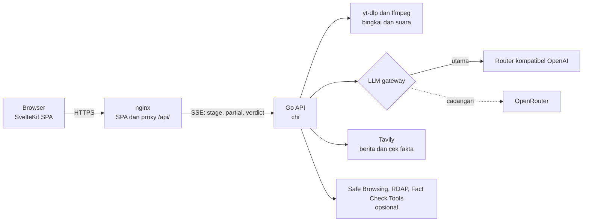

# AMBA: Aplikasi Mengenali & Bertindak Aman

AMBA adalah detektor hoaks dan konten buatan AI untuk bahasa Indonesia. Tempel
tautan video atau berita, atau unggah gambar, lalu AMBA memeriksa apakah isinya
buatan AI, apakah diedit untuk menyesatkan, apakah klaimnya dibantah sumber
terpercaya, dan apakah tautannya jebakan.

Alamat publik: **https://amba.madewadigital.com**

> Hasil AMBA bersifat **indikatif**. Ia bukan bukti pasti dan bukan alat bukti
> hukum. AMBA tidak pernah menyatakan sesuatu "pasti asli" atau "pasti palsu".

## Fitur

Semua fitur di bawah ini ada di kode saat ini (cabang `amba-v2`, 10 November 2026).

- **Tautan video** dari TikTok, YouTube Shorts, Instagram, Facebook, dan X.
  Server mengunduh video dengan `yt-dlp`, mengambil 6 bingkai dan 60 detik
  suara dengan `ffmpeg`, lalu model menganalisisnya. Yang dinilai: tanda
  buatan AI, penyuntingan yang menyesatkan, dan keterangan yang tidak cocok
  dengan isi rekaman. Suara hanya ikut dianalisis bila gateway menerima input
  audio (`LLM_AUDIO_INPUT`).
- **Pengakuan pembuat.** Judul, deskripsi, tag, dan nama akun dibaca untuk
  mencari pengakuan AI dari pembuatnya sendiri (misalnya `#veo3`, `#sora`,
  "dibuat dengan AI"). Pengakuan kuat menaikkan skor ke batas bawah 85;
  sebutan lemah seperti `#ai` hanya menambah 8 poin. Akun media berita dan
  judul yang membahas AI (bukan memakainya) tidak dihitung.
- **Pencarian jejak di web.** Judul dan deskripsi video dicari lewat Tavily,
  dibatasi ke situs berita dan cek fakta (daftar putih 26 situs). Tiap temuan
  disaring: harus satu topik dengan video, lalu dinilai model sebagai
  "AI", "asli", "hoaks", atau tidak relevan. Paling banyak 5 temuan
  ditampilkan. Butuh `TAVILY_API_KEY`; tanpa kunci langkah ini mati.
- **Cek fakta** dengan pencocokan topik berbahasa Indonesia (pemotongan
  imbuhan dan padanan kata, misalnya "wapres" dan "wakil presiden",
  "mundur" dan "mengundurkan diri"). Sumber hanya diterima bila berasal dari
  hasil pencarian AMBA sendiri dan situsnya ada di daftar putih.
- **Gambar.** Cek gambar buatan AI (metadata asal-usul, Content Credentials,
  tanda yang terlihat, dan penilaian model), cek **teks yang ditimpa**
  (ELA di sisi server), dan cek keamanan tautan.
- **Keamanan tautan.** Heuristik URL, pembukaan pengalihan, Safe Browsing
  (bila kunci diisi), umur domain, dan penanda **domain tiruan** (misalnya
  `faceb00k`, huruf Kiril yang mirip huruf Latin, nama merek di domain lain).
- **Teks bagikan yang ditempel.** Kalau yang ditempel adalah teks bagikan
  ("Lihat ini https://..."), tautannya diambil otomatis di browser. Skema
  berbahaya (`javascript:`, `data:`) ditolak sebelum dikirim.

Juga ada: halaman **Belajar** (tanda video buatan AI dan video hoaks, cara
cek sendiri, modus penipuan yang beredar di Indonesia, kuis 8 soal dengan
pembahasan, dan panduan kata sandi keluarga), bot Telegram opsional, dan
baca-lantang hasil.

Setiap pemeriksaan selalu berakhir dengan kesimpulan yang jelas: aman,
perlu diperiksa, atau kemungkinan hoaks/dimanipulasi. Hasilnya tidak pernah
berupa "belum cukup data". Pemeriksaan yang tidak relevan untuk jenis
masukan (misalnya ELA untuk video) tidak ditampilkan, dan sumber cek fakta
hanya yang membahas klaim yang sama.

### Fitur yang sudah dihapus

Supaya pembaca tidak bingung dengan dokumen atau tangkapan layar lama, fitur
berikut **sudah tidak ada** di v2:

- Ukuran teks (A / A+ / A++).
- Mode Jelajah dan Esensial.
- Bagikan laporan (tombol dan tampilan laporan bersama).
- Balas sopan (endpoint `/reply` dihapus).
- Kartu bukti (simpan gambar).
- Cek cepat (`/cek-cepat`); panduan keluarga pindah ke Belajar
  (`/panduan-keluarga` dialihkan ke `/edukasi#keluarga`).

Menu bagikan dari sistem operasi ke AMBA (PWA share target) tetap ada: itu
jalur masuk, bukan bagikan laporan.

## Arsitektur



Skor tidak pernah datang dari model. Paket `internal/scoring` adalah satu-satunya
tempat skor dihitung; model hanya mengembalikan temuan terstruktur. Gateway
utama dan cadangan diatur lewat variabel lingkungan (lihat `.env.example`).

```
backend/internal/
  security/    validator tautan, klien anti-SSRF, validasi unggahan, rate limit, CORS, header
  pipeline/    anggaran waktu per langkah, SSE progresif, degradasi, cache LRU
  video/       yt-dlp + ffmpeg, pengakuan pembuat, pengenal platform
  llm/         klien gateway (utama + cadangan, pemutus sirkuit), analisis, klasifikasi, video
  grounding/   daftar putih sumber, pencarian Tavily dan Fact Check Tools, SameTopic
  retrieval/   pencarian berita tanpa kunci (cadangan), disaring daftar putih
  forensics/   ELA dan bukti teks ditimpa
  linkcheck/   heuristik URL, pengalihan, Safe Browsing, umur domain (RDAP)
  provenance/  metadata asal-usul gambar (C2PA, XMP, EXIF, PNG text)
  aidetect/    detektor gambar AI opsional (Sightengine)
  scoring/     perhitungan skor, lantai, ambang
  token/       token bertanda tangan HMAC untuk /verify
  telegram/    bot opsional
  metrics/     penghitung anonim di listener internal
```

## Tumpukan teknologi

Versi diambil dari `frontend/package.json` dan `backend/go.mod`.

| Lapisan | Teknologi |
|---|---|
| Backend | Go 1.26 (image `golang:1.27-alpine`), chi v5.5.0, golang.org/x/net 0.62.0, x/image 0.45.0, x/text 0.43.0, x/sync 0.24.0, x/time 0.12.0 |
| Alat video | yt-dlp 2026.10.26 (dipatok di `backend/Dockerfile`), ffmpeg |
| Frontend | SvelteKit 3.1.1, Svelte 5.57.3, Vite 8.3.5, TypeScript 6.0.3, Tailwind CSS 3.4.19, Zod 4.6.7 (Node 22 atau lebih baru) |
| Tes | Go `testing` dengan `-race`, Vitest 5.0.5, Playwright 1.64.1, axe-core |
| Kontainer | Docker Compose; nginx 1.27 untuk SPA dan proxy; Alpine 3.21 untuk API |

## Menjalankan secara lokal

Cukup **Docker**.

```bash
cp .env.example .env          # opsional; bawaan sudah aman (LLM_MOCK=true)
docker compose up --build     # web http://localhost, API http://localhost:8080
docker compose down
```

Pintasan: `start.bat` / `./start.sh` dan `stop.bat` / `./stop.sh`. Kalau port 80
terpakai, set `FRONTEND_PORT=3000` di `.env`. Panduan lengkap ada di
[`docs/DOCKER.md`](docs/DOCKER.md).

Dengan `LLM_MOCK=true` (bawaan) AMBA memakai temuan tiruan dan tidak mengunduh
video. Untuk analisis sungguhan isi `.env`: `LLM_MOCK=false`, kunci gateway
LLM (`NINEROUTER_API_KEY`, nama variabel lama untuk gateway kompatibel OpenAI),
dan `NINEROUTER_MODEL`. `TAVILY_API_KEY` mengaktifkan pencarian web. Semua
variabel dijelaskan di [`.env.example`](.env.example). Kunci hanya boleh ada di
`.env` atau secret hosting, tidak pernah di git.

Pengembangan dengan hot-reload: `make dev` (API :8080, web :5173).
`npm run dev` memakai data contoh (mode mock) dan menampilkan banner
"Mode pratinjau". Untuk backend sungguhan:
`VITE_API_MODE=http VITE_API_BASE_URL=http://localhost:8080/api/v1 npm run dev`.
Backend tidak membaca file `.env` sendiri; Docker Compose yang meneruskannya.

## Tes dan pemeriksaan

```bash
# backend
cd backend && gofmt -l . && go vet ./... && go test -race ./...
cd backend && go run ./cmd/gendemo && git status --porcelain   # harus kosong

# frontend
cd frontend && npm ci && npm run typecheck && npm run lint && npm run test
cd frontend && npm run build && npm run size && npm run contrast && npm run headers

# end-to-end (menyalakan Go dan preview sendiri; sekali: npx playwright install chromium)
cd frontend && npm run test:e2e
```

| Perintah | Menjaga apa |
|---|---|
| `go test -race ./...` | seluruh backend: skor, validator tautan, SSRF, pengakuan pembuat, SameTopic, pipeline |
| `go run ./cmd/gendemo` | data demo dibuat ulang tanpa diff |
| `npm run typecheck`, `lint`, `test` | Svelte + TypeScript, ESLint (termasuk a11y), Vitest |
| `npm run contrast` | kontras warna WCAG AA di tema gelap dan terang |
| `npm run size` | total JS awal di bawah 250 KB gzip |
| `npm run headers` | header host sama dengan `security-headers.json` |
| `npm run test:e2e` | alur tautan sampai `/hasil`, unggah gambar, rate limit, bahasa, axe |

E2e butuh build dengan `VITE_API_BASE_URL=http://localhost:8080/api/v1`. Rate
limit API bisa menolak audit terakhir pada putaran yang sangat cepat, jadi
`playwright.config.ts` mengulang sekali.

## Keamanan

- **Validator tautan** (`security.ValidateInputURL`) adalah satu pintu untuk
  `/audit/url`. Hanya `http` dan `https`; tanpa nama pengguna atau kata sandi
  (termasuk `@` yang diselundupkan); port hanya kosong, 80, atau 443;
  maksimal 2048 karakter; tanpa spasi atau karakter tersembunyi (lebar nol,
  bidi); tanpa karakter berbahaya (`<`, `>`, `"`, tanda petik balik) atau
  penyandian persennya; host dinormalkan ke punycode. Tautan ditolak dengan
  kode `INVALID_URL` dan pesan Indonesia yang spesifik. Tanda petik tunggal
  boleh, karena slug berita memakainya.
- **Pengenal platform** mencocokkan host persis dan hanya `https`.
  `tiktok.com.contoh.xyz` dan tautan dengan `@` tidak dikenali.
- **Penjaga SSRF.** Setiap pengambilan keluar lewat klien yang menolak alamat
  loopback, privat, link-local (termasuk alamat metadata cloud), dan rentang
  khusus lain, diperiksa saat menyambung dan di setiap pengalihan. `yt-dlp`
  dijalankan tanpa shell, dengan `--ignore-config` dan `--` sebelum URL.
- **Rate limit:** 30 permintaan per menit per klien (burst 10) dan 32 audit
  bersamaan. Kunci klien di-hash dengan garam yang berganti saat boot.
- **Header dan CSP** (`frontend/nginx.conf`): `X-Content-Type-Options: nosniff`,
  `Referrer-Policy: no-referrer`, `Permissions-Policy` (kamera, mikrofon, lokasi
  mati), `X-Frame-Options: DENY`, CSP `frame-ancestors 'none'`, dan HSTS
  `max-age=31536000`. Header yang sama diulang di `location /_app/` karena
  nginx membuang header tingkat server bila sebuah location punya
  `add_header`. CSP penuh (`script-src` berhash, `connect-src` dari alamat API
  saat build) dibuat SvelteKit.
- **Penahanan prompt injection.** Teks dari luar dibungkus
  `<untrusted_content>` dan dinyatakan sebagai data; skema keluaran model tidak
  punya kolom skor atau vonis; pola perintah ("abaikan instruksi", "ubah hasil")
  dan penanda dari model memicu lantai `INJECTION_GUARD`; sumber karangan
  model tidak lolos karena harus ada di hasil pencarian AMBA dan di daftar putih.
- **Tanpa data pengguna disimpan.** Tidak ada akun atau basis data. Hasil hanya
  ada di memori (cache 10 menit). Log tidak memuat URL, teks, judul, atau IP.

## Privasi

Tautan atau gambar yang Anda kirim diproses di server AMBA dan diteruskan ke
layanan yang diperlukan: gateway model (bingkai, suara, dan teks), Tavily
(kalimat pencarian dari judul video), dan, bila diaktifkan, Safe Browsing,
Fact Check Tools, RDAP (hanya nama domain), dan Sightengine. Tidak ada yang
disimpan setelah hasil dikirim. Halaman Tentang di aplikasi menjelaskan hal
yang sama untuk pengguna.

## Batasan yang diketahui

- Akurasi 90 persen belum diklaim. Dalam tiga putaran atas 33 klip berlabel
  (11 berita asli, 10 buatan AI, 12 hoaks), ambang saat ini menandai 1 dari 33
  bacaan berita asli (3 persen) dan 16 dari 30 bacaan klip AI (53 persen).
  Pencarian web belum terukur di set itu. Rincian di `docs/DECISIONS.md`.
- Isi video yang dikunci login atau privat tidak bisa diambil; hasil
  menyatakannya.
- ELA melemah pada PNG dan tangkapan layar yang sudah disimpan ulang.
- Pengakuan pembuat yang kuat sendirian sudah menghasilkan skor minimal 85;
  unggahan satir yang menyebut "AI" di judul bisa memicunya.
- Tavily memakai satu kredit tambahan per video.

## Tim: Pecut Claude

| Nama | Peran |
|---|---|
| Mursyid Dwi Wahidiyantoro | PM / Arsitek |
| M. Ridho Ansyori | UI/UX |
| Bagus Joshua Parabang | Backend Golang |
| Jericho Mikael Tuapardi L | Frontend |

## Struktur repo

```
api/          kontrak OpenAPI + JSON Schema Dossier
backend/      Go 1.26 + chi
frontend/     SvelteKit SPA (id/en), nginx.conf
configs/      daftar putih sumber tepercaya
docs/         DEPLOY.md, DEPLOY-NETLIFY.md, DOCKER.md, PROGRESS.md, DECISIONS.md, DESIGN-SYSTEM.md
instruction/  PRD, spesifikasi teknis, acuan desain
tools/        eval (kalibrasi), textbench, check-demo-diff
```

Status terkini: [`STATUS.md`](STATUS.md). Spesifikasi teknis:
[`instruction/TECH_SPEC_AMBA.md`](instruction/TECH_SPEC_AMBA.md). Deploy:
[`docs/DEPLOY.md`](docs/DEPLOY.md).
